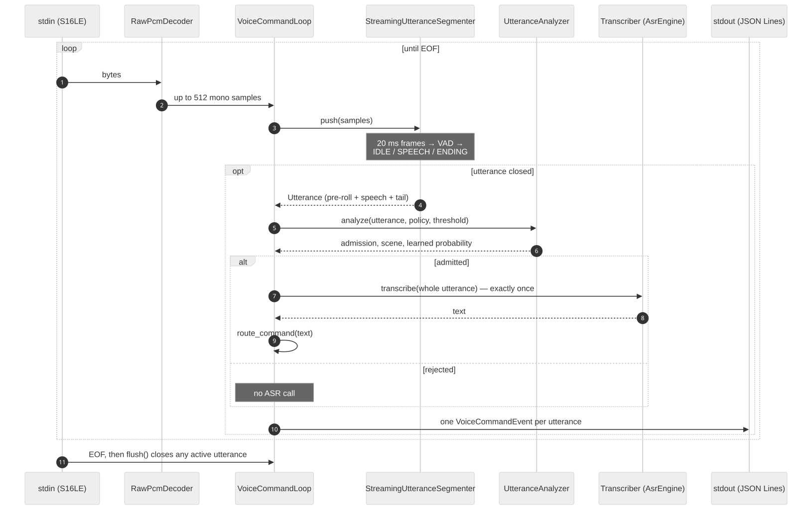

# Architecture

This document describes how `edge_audio` is put together: the subsystems, the
two pipelines built from them, the contracts between them, and the decisions
behind the design. API-level detail lives in the Doxygen reference
(`docs/Doxyfile`); every subsystem below maps to a Doxygen group.

## Design goals

ASR is the dominant cost on an edge device. A Whisper call costs hundreds of
milliseconds of CPU or GPU, while computing the features below costs microseconds.
The runtime is therefore built around one idea: **decide whether audio is worth
transcribing before paying for it**, and make that decision cheap,
explainable and testable.

| Goal | Consequence in the design |
|---|---|
| Spend ASR only on useful audio | Quality admission runs before ASR; ASR runs **at most once** per file or utterance. |
| Run on small devices | Dependency-free C++17 DSP; the learned model is ~36 KB of `constexpr` tables, ~1 µs per call. |
| Learned behaviour must match training | The native model is generated from the trained artifact and checked against scikit-learn on 3,400 examples. |
| Every decision is observable | Every window (offline) and every utterance (streaming) produces a structured record, including rejections. |
| Core logic testable without models | ASR is behind a `Transcriber` callable; the core library never links whisper.cpp. |

## System overview



Two executables share one core library:

- **`audio_pipeline`**: offline. Takes a complete WAV, decides admission under
  a rule, learned or hybrid policy, optionally transcribes, and writes per-window
  records plus a JSON report.
- **`voice_command_stream`**: streaming. Reads raw PCM from stdin, segments it
  into utterances, admits each one, transcribes admitted utterances once, and
  emits one JSON command event per utterance.

The learned quality model is trained offline in Python and compiled into the
binary as generated C++ (see [quality_model.md](quality_model.md)).

## Code layout and dependency rules



```
src/edge_audio/
  audio/          AudioBuffer, WAV loading, resampling, RawPcmDecoder
  segmentation/   fixed windows, frame VAD, streaming utterance segmenter
  quality/        spectral features, rule gate, scene, adaptive control,
                  file features, native GBDT, admission policy, utterance analyzer
  asr/            Transcriber interface (core) and AsrEngine (whisper.cpp, separate target)
  command/        command router, VoiceCommandEvent, VoiceCommandLoop
  report/         RunLogger and JSON escaping
apps/             the executables (thin: argument parsing and wiring only)
tests/            GoogleTest suite, stream protocol test, parity corpus
tools/python/     feature mirror, training, export, offline evaluation
```

Rules the build enforces:

1. `edge_audio_core` depends only on the standard library and dr_wav. It does
   not see whisper.cpp; it reaches ASR only through `Transcriber`
   (`asr/transcription.h`).
2. `edge_audio_asr` is the only target that links whisper.cpp.
3. `apps/` contain no algorithms. They parse arguments, wire subsystems and
   choose output formats.
4. Tests link `edge_audio_core` only, so `ctest` needs no model weights.

## Subsystems

### Audio input (`audio/`)

Everything downstream consumes **mono float PCM in [-1, 1]**.

- `load_wav()` decodes any dr_wav-supported WAV and downmixes by averaging
  channels. `resample()` is linear interpolation: adequate for a speech
  front-end, deliberately not a hi-fi resampler.
- `RawPcmDecoder` decodes an unbounded S16LE stream in blocks of at most 512
  frames using a 3-byte carry buffer, so memory is constant regardless of
  stream length and reads may split samples at any byte. Stereo is downmixed
  in integer arithmetic before scaling, so it cannot overflow. A trailing
  partial frame is a malformed stream: decoded frames are still delivered and
  the error is reported on the next call.

### Segmentation (`segmentation/`)

| Unit | Used by | Why |
|---|---|---|
| `chunk_audio()` (fixed 5 s, no overlap) | offline, utterance analysis | The learned model's training unit. |
| `run_vad()` + `pack_vad_segments()` | offline, rule policy only | Transcribe speech regions only; packing trades a little padding for fewer ASR calls (per-call overhead dominates on GPU). |
| `StreamingUtteranceSegmenter` | streaming | Endpointing a live stream into utterances with bounded memory. |

All three use one frame classifier, `vad_frame_is_speech()`: a 20 ms frame is
speech if its RMS reaches 0.005 and its zero-crossing rate stays below 3,000/s.

**Utterance segmentation.** The streaming endpointer is a three-state machine
advanced once per 20 ms frame:


| Parameter | Default | Effect |
|---|---:|---|
| `speech_start_frames` | 2 | Consecutive speech frames that open an utterance (40 ms). |
| `pre_roll_ms` | 250 | Audio kept before the trigger so word onsets are not clipped. |
| `end_silence_ms` | 600 | Trailing silence that closes an utterance; the main latency/accuracy trade-off. |
| `min_speech_ms` | 200 | Shorter candidates (clicks, bumps) are discarded without ASR. |
| `max_utterance_ms` | 8000 | Hard cap; bounds memory and worst-case ASR latency. |

Memory is bounded by construction: under one frame of partial samples, at most
`pre_roll_ms` of pre-roll, and at most `max_utterance_ms` of utterance (about
0.5 MB at 16 kHz). `push_frame()` injects explicit speech decisions so the
state machine is tested deterministically, independent of the VAD.

### Quality admission (`quality/`)



Every 5 s window is reduced to **12 metrics** (`GateMetrics`): RMS, silence
ratio, clipping ratio and zero-crossing rate in the time domain, plus spectral
flatness, centroid, rolloff, flux, low/mid/high band energy fractions and
active-frame fraction from a Hann-windowed radix-2 FFT (512-point frames, 50%
overlap). Three consumers share these metrics:

1. **Rule gate** (`evaluate_chunk`). Ordered checks, cheapest first; the first
   match decides: energy floor → silence → clipping → frame activity →
   flatness (alone, and with ZCR) → voice-band presence → high-band dominance →
   two BORDERLINE rules → PASS. Each verdict carries a stable reason string.
2. **Scene classifier** (`classify`). SILENCE, NOISE, MUSIC, SPEECH,
   MIXED_SPEECH_NOISE or UNKNOWN, with a heuristic confidence.
3. **File features** (`QualityFeatureAggregator`). Mean and max of the 12
   metrics plus the PASS/BORDERLINE/FAIL fractions: the **27-feature vector**
   scored by the learned model. Metrics are rounded to 6 decimals before
   aggregation, exactly as the Python extractor does, which is what makes
   native and Python vectors identical.

The **AdaptiveController** keeps the last five scene labels. When NOISE
dominates it tightens the gate's energy and flatness thresholds for the next
window, and it suppresses ASR for windows labelled MUSIC or SILENCE.

**Policies** (`decide_quality_admission`):

| Policy | Admit when | ASR granularity (offline) |
|---|---|---|
| `rule` | any window passes the gate and is not music/silence | each admitted window |
| `learned` | GBDT probability ≥ threshold (default 0.3, chosen on validation) | whole file, once |
| `hybrid` | both rule and learned admit | whole file, once |

`learned` and `hybrid` are only defined on the training-time input: fixed,
non-overlapping 5 s windows with the default gate. The CLI refuses other
combinations rather than scoring inputs the model never saw.

**Utterance analysis.** `UtteranceAnalyzer` runs this file-level path on a
single completed utterance (resample → 5 s windows → features → one model
call). Streaming admission therefore makes the same decision the model was
evaluated on. It does not apply the adaptive controller, because utterances
are short and independent.

### Speech recognition (`asr/`)

`Transcriber` is a `std::function<AsrResult(const float*, int)>`. The rest of
the runtime only ever calls `transcribe_if_admitted()`, the single place where an
admission verdict turns into ASR compute, which enforces "zero or one call per
file or utterance".

`AsrEngine` owns one whisper.cpp context (greedy decoding, no timestamps). With
`GGML_CUDA=ON` it initialises on GPU 0 and falls back to the CPU if that fails;
`backend_mode()` reports which backend is active. Apps load the model lazily,
so analysis-only runs and fully rejected files never pay for model loading.

### Voice commands (`command/`)

`route_command()` normalises the transcript (lower-case, collapse whitespace,
strip trailing punctuation) and requires an **exact** match:

| Phrase | Intent | Action |
|---|---|---|
| go forward / go backward | `GO_FORWARD` / `GO_BACKWARD` | `go_forward` / `go_backward` |
| turn left / turn right | `TURN_LEFT` / `TURN_RIGHT` | `turn_left` / `turn_right` |
| look left / look right | `LOOK_LEFT` / `LOOK_RIGHT` | `look_left` / `look_right` |
| stop | `STOP` | `stop` |
| come here | `APPROACH` | `approach` |
| cancel | `CANCEL` | `cancel` |
| anything else | `UNKNOWN` | `null` |

Exact matching is a safety choice: a mis-transcription becomes `UNKNOWN`, never
a different command.

**Event schema.** One JSON object per line, one line per utterance, emitted for
rejected utterances too:

| Key | Type | Meaning |
|---|---|---|
| `event` | string | Always `voice_command`. |
| `utterance_id` | int | Monotonic from 1. |
| `capture_device`, `transport` | string | Caller-supplied labels. |
| `duration_ms` | int | Utterance length, including pre-roll and tail. |
| `finalization_reason` | string | `end_silence`, `max_duration` or `end_of_stream`. |
| `scene`, `scene_confidence` | string, number | Highest-confidence scene across windows. |
| `quality_policy`, `quality_threshold` | string, number | Admission configuration. |
| `quality_probability` | number | Learned probability (0 under `rule`). |
| `rule_summary`, `admitted` | bool | Rule verdict and final verdict. |
| `rejection_reason` | string | Empty when admitted. |
| `asr_ran`, `asr_error`, `transcript` | bool, string, string | ASR outcome. |
| `intent`, `action` | string, string or null | Routing result. |
| `latency.quality_us` | number | Quality analysis time. |
| `latency.asr_ms` | number | Whisper decode time. |
| `latency.post_utterance_ms` | number | Utterance close to event serialised. |
| `stream.frames_processed` | int | Stream frames up to this utterance's end. |

### Reporting (`report/`)

`RunLogger` prints one tab-separated `key=value` line per event (`run_start`,
`chunk`, `quality_summary`, `run_end`) and, with `--report`, writes a JSON
report with `config`, `chunks`, `quality` and `summary` sections. All JSON
output goes through one RFC 8259 escaper.

## Pipelines

### Offline: `audio_pipeline`



### Streaming: `voice_command_stream`



stdout carries only JSON Lines; diagnostics go to stderr, so the output can be
piped directly into a consumer (a robot controller, `jq`, a log shipper).

## Concurrency and resource model

Both pipelines are **single-threaded and synchronous**. This keeps every
decision deterministic and replayable. Feeding the same bytes produces the same
events, which the tests and the replay script rely on. The cost is explicit:

- In the streaming loop, ASR runs inside `push()`. While Whisper decodes an
  admitted utterance (tens of milliseconds on a laptop GPU, hundreds on CPU),
  the decoder stops reading stdin. The OS pipe buffers the audio, so nothing
  is lost at these durations, but a long decode delays segmentation of the
  next utterance.
- Latency is reported per stage in every event. `post_utterance_ms` measures
  from utterance close to event emission. It excludes the speech itself and
  the `end_silence_ms` endpoint wait, so it is **not** microphone-to-action
  latency.

The natural evolution, if needed, is a two-stage pipeline: capture and
segmentation on one thread, a bounded queue of completed utterances, and ASR
on a worker. The `Transcriber` seam and the per-utterance event already make
that a local change.

| Resource | Bound |
|---|---|
| Stream decoder | 3 bytes carry + one 512-frame block |
| Segmenter | pre-roll + `max_utterance_ms` of audio (~0.5 MB at 16 kHz) |
| Learned model | 36,112 bytes static data, no allocation per call |
| File features | 224-byte accumulator |
| Offline pipeline | the decoded file plus its window copies (≈ 2× the file in float32) |

## Error handling

- **Configuration errors** (bad sample rate, inconsistent segmenter config,
  threshold outside [0, 1]) throw `std::invalid_argument` at construction or
  parse time. The apps exit with status 2 before loading any model.
- **Data errors** (unreadable WAV, malformed PCM tail, non-finite features)
  are reported with context. The stream app still emits events for audio
  decoded before the error, then exits non-zero.
- **ASR failures** are data, not exceptions. The event carries `asr_error`,
  routing yields `UNKNOWN`, and the stream exits non-zero at the end if any
  admitted utterance failed.
- **Model integrity**: `predict_quality()` validates feature count, finiteness
  and threshold. The tree walker checks node indices and leaf shape, so a
  corrupted generated table fails loudly instead of returning garbage.

## Design decisions

**A tree ensemble exported to `constexpr` tables, not ONNX or a runtime.** One
hundred depth-3 trees evaluate in about a microsecond with no allocation and no
dependency. Generating C++ from the artifact makes the shipped model
reviewable in a diff and pinned by SHA-256 in the binary. A parity test against
scikit-learn's recorded outputs keeps the export honest.

**File-level features over 5 s windows.** The model scores whole files or
utterances, which is the unit that decides whether ASR runs. Features are
aggregated over the same windows the rule gate uses, so the learned model
consumes the gate's decisions as three of its features rather than replacing
them.

**ASR at most once.** Learned and hybrid transcribe the whole buffer once
instead of per window. This avoids cutting words at window edges and gives the
predictable cost profile edge deployments need.

**Exact-match routing.** In a control setting a false command is worse than a
missed one. Robust intent understanding belongs in a separately evaluated
component behind the same event interface.

**A core library without whisper.cpp.** Faster builds, model-free tests, and a
clean seam for swapping the ASR backend (a different Whisper size, a streaming
recogniser, a remote service).

## Known limitations

- The learned model is trained on class-balanced, largely synthetic data
  (LibriSpeech mixed with MUSAN, DEMAND and simulated reverb), so its error
  rates are not field estimates. Music and stationary noise are its main false
  accepts. See [quality_model.md](quality_model.md).
- The model was trained on 5 s and longer files. On short live commands its
  probabilities are not calibrated, so `rule` is the recommended streaming
  policy until it is recalibrated on command-length audio.
- The frame VAD is an energy/ZCR classifier. It is cheap and transparent, but
  weaker than a neural VAD in non-stationary noise.
- Streaming is single-threaded (see above), English-only by default, and
  WAV/S16LE-only on input.
