# Quality model

The learned admission model predicts, from 27 cheap DSP features, whether a
file or utterance is worth sending to Whisper. This document covers the data
protocol, the results, and how the trained model reaches the C++ runtime with
a parity guarantee.



## Task and labels

One example is **one complete audio file**. Every synthetic example is rendered
at 16 kHz and is exactly 5 s long; `clean_speech` examples are the original
LibriSpeech utterances (FLAC, typically 2–35 s). The target is binary:
`should_transcribe = yes` for speech that ASR can use, `no` otherwise.

| Label | Class | Construction |
|---|---|---|
| `clean_speech` | yes | LibriSpeech utterance, original length |
| `speech_in_noise` | yes | 5 s of LibriSpeech mixed with MUSAN or DEMAND noise |
| `speech_in_reverb` | yes | 5 s of LibriSpeech convolved with a simulated room impulse response |
| `music` | no | MUSAN music |
| `stationary_noise` | no | MUSAN or DEMAND noise |
| `clipped_or_distorted` | no | speech hard-clipped at 0.1–0.4 full scale |
| `low_utility` | no | 0.5 s of speech attenuated to 5%, then silence |

## Splits and leakage control

Speech comes from disjoint LibriSpeech partitions: `train-clean-100` for train,
`dev-clean` for validation and `test-clean` for test. Noise, music and impulse
response sources were partitioned deterministically before any example was
rendered (seed 123), so no source recording appears in two splits.

| Split | Rows | yes / no | clean | +noise | +reverb | music | noise | clipped | low utility |
|---|---:|---:|---:|---:|---:|---:|---:|---:|---:|
| Train | 1,700 | 1,000 / 700 | 400 | 400 | 200 | 200 | 150 | 200 | 150 |
| Validation | 1,700 | 1,000 / 700 | 400 | 400 | 200 | 200 | 150 | 200 | 150 |
| Test | 1,700 | 1,000 / 700 | 400 | 400 | 200 | 200 | 150 | 200 | 150 |

After rendering, every split pair was checked for shared canonical sources,
base utterances, derived-example fingerprints, output paths and content
hashes. All counts were zero (`artifacts/quality_model_v1/overlap_report.json`).
Label files are pinned by SHA-256 in `model_metadata.json`.

## Features

Each file is cut into non-overlapping 5 s windows (the last may be shorter).
Every window yields the 12 `GateMetrics` (see
[architecture.md](architecture.md#quality-admission-quality)). The file vector
is:

- the **mean** of each metric over windows (12),
- the **maximum** of each metric over windows (12),
- the fraction of windows the rule gate marked **PASS / BORDERLINE / FAIL** (3).

Training features are computed by `tools/python/eval/gate_eval.py`, a NumPy
mirror of the C++ DSP. Each metric is rounded to six decimals before
aggregation, on both sides.

Every synthetic example is a single 5 s window, so for those the mean and
maximum halves of the vector are identical and the gate fractions are one-hot.
Only `clean_speech` files span several windows.

## Model and threshold

`sklearn.ensemble.GradientBoostingClassifier`: 100 trees, depth 3, learning
rate 0.1, `random_state=42`, no scaling or class weights. The threshold was
picked by maximum F1 over 0.1–0.9 on **validation only** (0.3) and applied
once to test.

## Results

Held-out test split, threshold 0.3:

| Split | TP | FP | TN | FN | FAR | FRR | Precision | Recall | F1 |
|---|---:|---:|---:|---:|---:|---:|---:|---:|---:|
| Validation | 979 | 153 | 547 | 21 | 0.219 | 0.021 | 0.865 | 0.979 | 0.918 |
| **Test** | **986** | **157** | **543** | **14** | **0.224** | **0.014** | **0.863** | **0.986** | **0.920** |

FAR is the false-accept rate (useless audio sent to ASR); FRR is the
false-reject rate (usable speech dropped). The operating point favours recall:
dropping a real command costs more than one wasted decode.

**Errors by label (test).** All 157 false accepts are non-speech: 82 music, 56
stationary noise, 19 clipped. The 14 false rejects are 2 clean, 6 noisy and 6
reverberant speech. Per-example rows are in `false_accepts_test.csv` and
`false_rejects_test.csv`.

**Policy comparison** on the same 1,700 test rows. "ASR calls" counts one call
per admitted file. Reproduce with
`python tools/python/eval/evaluate_quality_policies.py`.

| Policy | TP | FP | TN | FN | F1 | ASR calls | Calls avoided |
|---|---:|---:|---:|---:|---:|---:|---:|
| Rule gate (file-level PASS/BORDERLINE) | 957 | 416 | 284 | 43 | 0.807 | 1,373 | 19.2% |
| **Learned** | 986 | 157 | 543 | 14 | **0.920** | 1,143 | 32.8% |
| Hybrid (rule ∧ learned) | 944 | 127 | 573 | 56 | 0.912 | 1,071 | 37.0% |

The learned policy removes 62% of the rule gate's false accepts while cutting
its false rejects by two thirds.

**Native runtime on audio.** `evaluate_policies` runs the full C++ path (WAV
loading, DSP, gate, scene, adaptive controller, aggregation, native model) on
the 1,300 WAV test files. The 400 clean-speech files are FLAC, which the
runtime does not load.

| Policy | TP | FP | TN | FN | F1 | ASR calls |
|---|---:|---:|---:|---:|---:|---:|
| Rule (with scene skip + adaptive) | 334 | 263 | 437 | 266 | 0.558 | 597 |
| Learned | 588 | 157 | 543 | 12 | 0.874 | 745 |
| Hybrid | 328 | 81 | 619 | 272 | 0.650 | 409 |

The runtime rule path is much stricter than the file-level baseline above,
because its scene classifier labels many noisy and reverberant speech windows
MUSIC or SILENCE and skips them. Hybrid inherits those rejections. This is
the main reason the learned policy, not the hand-tuned rules, is the
recommended offline admission policy.

**Feature importance** (impurity-based, not causal): `flux_max` 0.205,
`rms_mean` 0.130, `band_high_max` 0.122, `clipping_ratio_mean` 0.121,
`flux_mean` 0.095, `active_frac_max` 0.065, `band_low_max` 0.063.

## From artifact to C++

`artifacts/quality_model_v1/` is the source of truth: the joblib model,
feature schema, operating point, validation/test feature tables and
predictions, metrics, and `model_metadata.json`. The metadata records exact
argv, package versions, label hashes and the SHA-256 of every other file.

`tools/python/export/export_quality_model.py` produces two outputs:

| Output | Command | Requires |
|---|---|---|
| `src/edge_audio/quality/quality_model_data.h` | `--header-only` | the recorded scikit-learn version (1.8.0); pickles are version-specific |
| `tests/data/quality_model_v1_parity.bin` | `--corpus-only` | NumPy only |

The header holds the trees as `constexpr` arrays (1,488 nodes, 36 KB) together
with the model SHA-256, the metadata SHA-256 and the selected threshold. Before
writing it, the exporter checks that scikit-learn's own predictions equal the
formula the C++ code implements (`init + 0.1 · Σ tree(x)`, then the logistic
function) on every held-out vector.

The parity corpus holds all 3,400 validation and test feature vectors with the
probability scikit-learn produced for each at training time.
`QualityModelParity` scores every vector natively and requires **identical
decisions** and a **maximum probability difference of at most 1e-12**. The
observed maximum is 1.1e-16, one rounding step of a double. CI regenerates the corpus and checks that it
is byte-identical to the committed file.

## Reproducing

```bash
conda env create -f environment.yml && conda activate edge-audio
bash scripts/datasets/download_stage1.sh --full
python scripts/datasets/build_manifests.py --datasets musan rirs demand --validate
python scripts/datasets/build_quality_train.py --all-splits --overwrite --seed 123
python tools/python/training/train_quality_model.py --authoritative-protocol \
    --train-labels data/labels/quality_train.jsonl \
    --val-labels   data/labels/quality_val.jsonl \
    --test-labels  data/labels/quality_test.jsonl \
    --save-artifact artifacts/quality_model_v1 --seed 42
python tools/python/export/export_quality_model.py
```

Training finishes by reloading the saved model in a fresh process and checking
that it reproduces `test_predictions.csv` exactly.

## Limitations

- Data is class-balanced and largely synthetic, so the error rates above are
  not field estimates and do not reflect real-world class prevalence.
- Music and stationary noise account for every false accept. Spectral
  statistics alone separate them poorly from speech.
- **Length confound.** Clean speech is the only class with multi-window files
  (mean ≠ max, fractional gate counts), so the model can partly learn "longer
  file ⇒ speech". Synthetic speech is 5 s and is still admitted at 98.0%
  recall (588 of 600), but the next dataset revision should render every class at matched
  lengths. Relatedly, the label files record `duration_sec: 5.0` for clean
  speech because the LibriSpeech manifests carry no durations.
- **Short inputs.** 1–2 s voice commands are outside the training
  distribution and their probabilities are not calibrated. Recalibrating on
  command-length audio is the next step before using `learned` in the
  streaming path.
- The threshold comes from a coarse 0.1-step grid.
- English read speech only. No far-field, multi-speaker or device-specific
  evaluation.
